# Progress PBL: Mikrotik & Raspberry Pi

| | |
|---|---|
| **Nama** | Farel Tre Juandi |
| **Kelas** | TMJ 5A |
| **PIC PBL** | IoT Device Development, Protocol & Broker Configurator, Traffic Simulation & Testing |
| **Mata Kuliah** | Dokumentasi Jaringan |
| **Judul PBL** | Pengembangan IoT Traffic Generator Multi-Protokol MQTT, HTTP, CoAP untuk Pengujian Sistem Deteksi Anomali |

## 1. Mikrotik

### 1.1 Membuat IP DHCP Client dari ISP
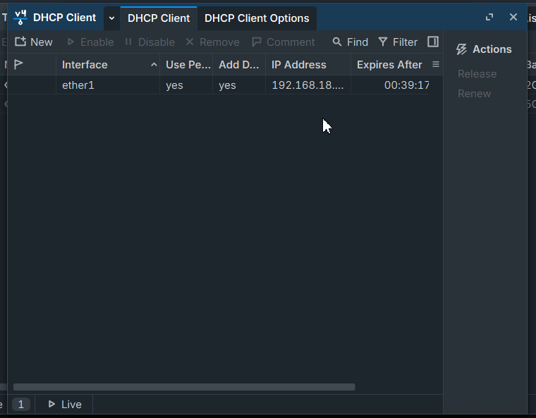

### 1.2 Menyalakan beberapa port dan menambahkan IP pada tabel IP
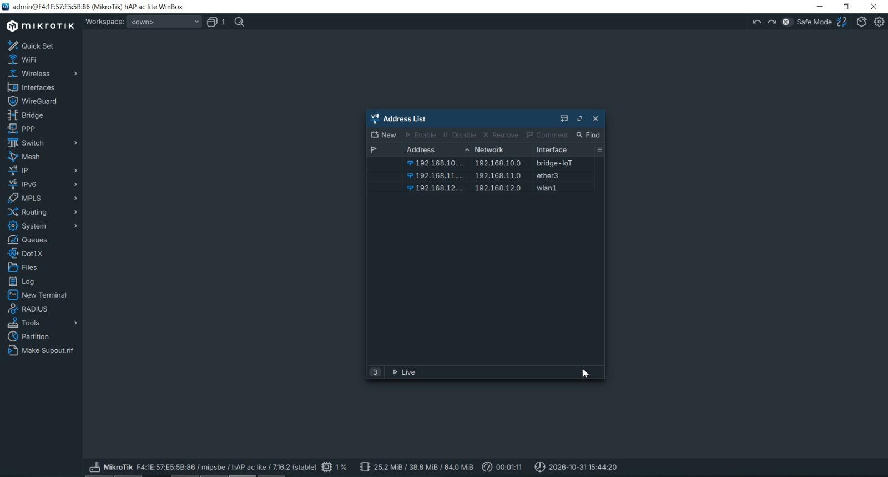

### 1.3 Membuat IP DHCP Server untuk client
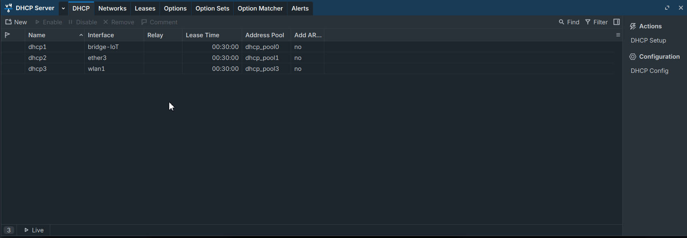

### 1.4 Tabel pengguna IP DHCP pada DHCP Lease
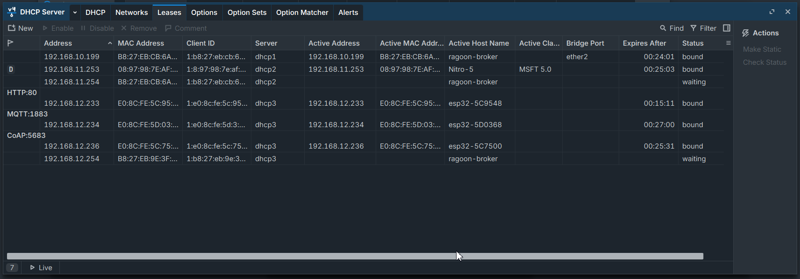

### 1.5 Membuat interface wireless wlan1
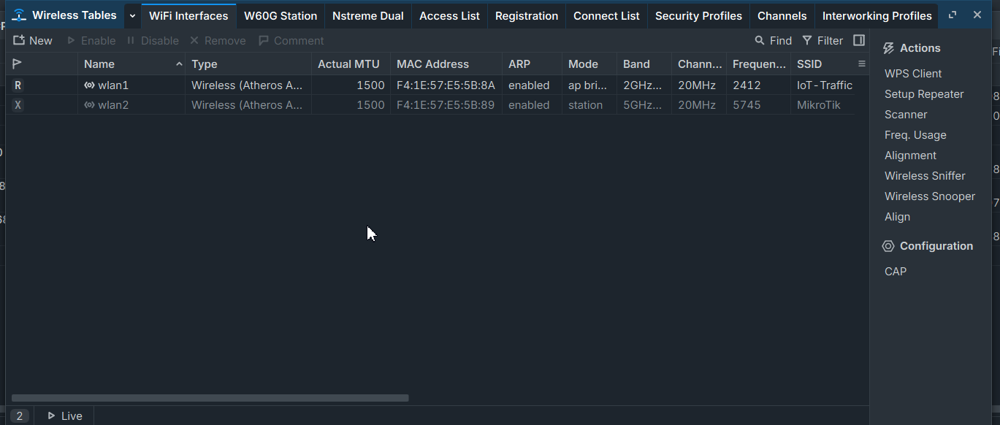

### 1.6 Konfigurasi SSID dan password pada Security Profiles (Wireless Table)
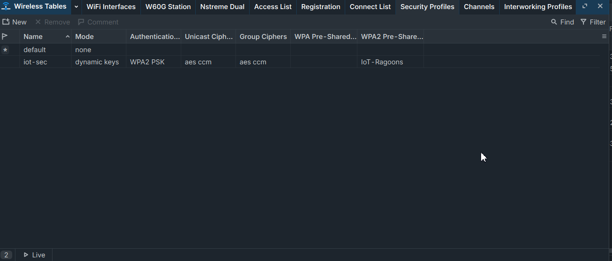

### 1.7 Membuat NAT mode srcnat Masquerade
Agar client bisa mengakses internet. Konfigurasi berada pada tabel Firewall.

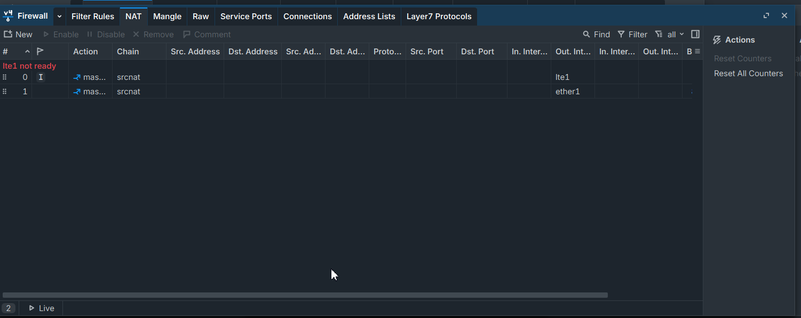

### 1.8 Membuat Port Mirroring di port ether2 dan ether3
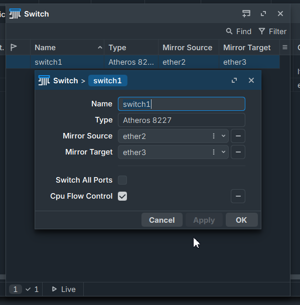

## 2. Raspberry Pi

### 2.1 Instalasi lewat Raspberry Pi Imager: pilih device
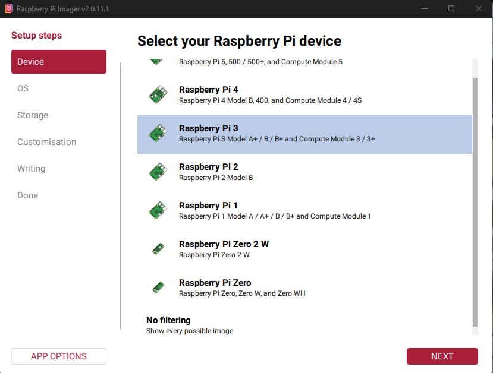

### 2.2 Memilih operating system
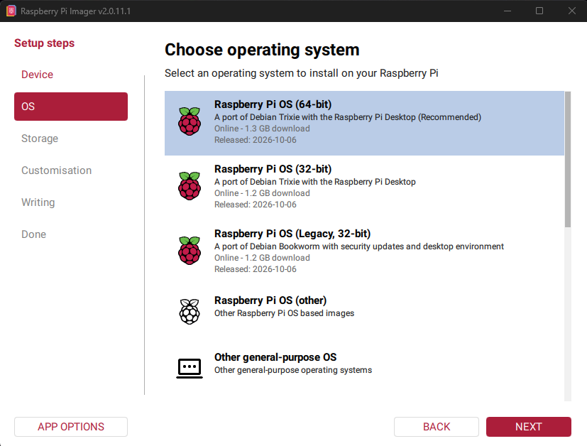

### 2.3 Memilih storage device untuk instalasi
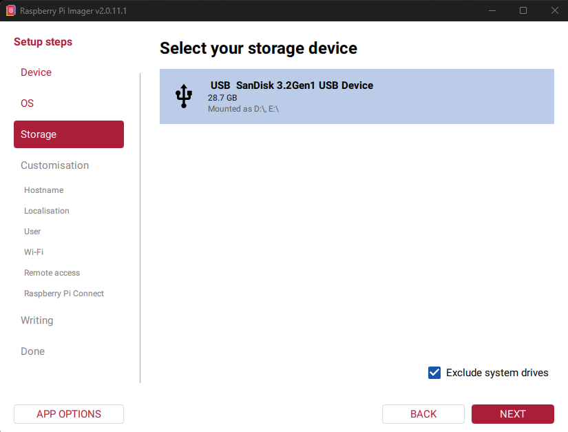

### 2.4 Mengisi hostname
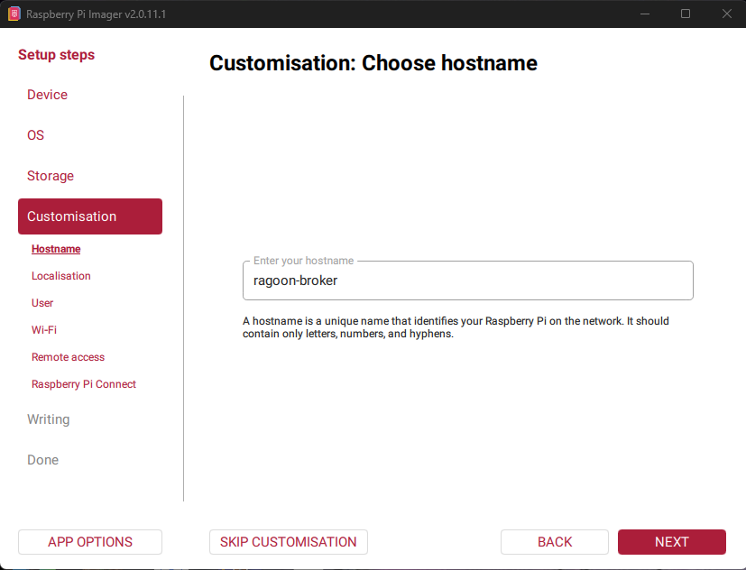

### 2.5 Memilih lokasi, timezone, dan keyboard layout
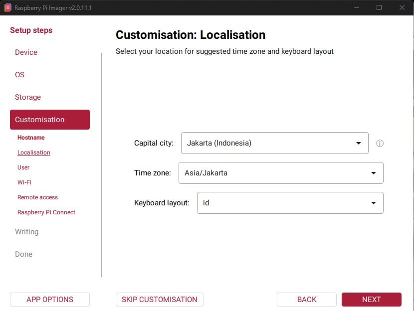

### 2.6 Membuat akun (username dan password)
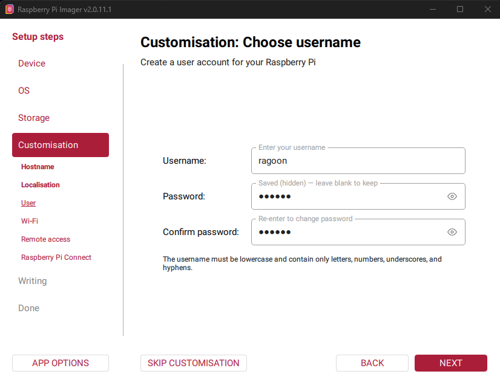

### 2.7 Mengisi jaringan Wi-Fi (SSID dan password)
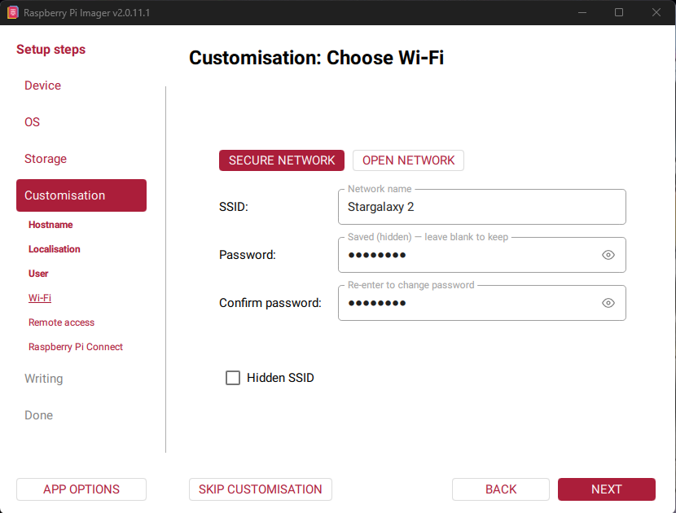

### 2.8 Menyalakan SSH
Opsi password dipilih agar Raspberry Pi bisa diremote.

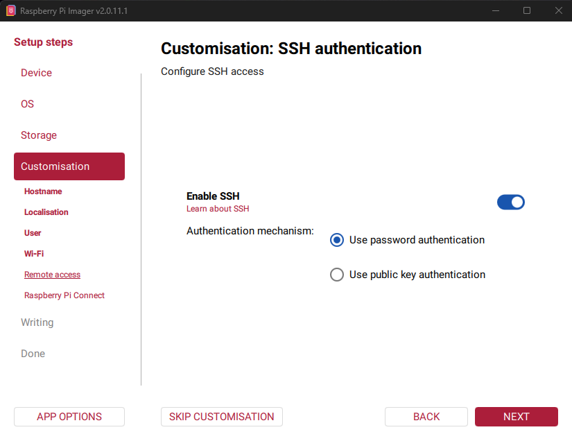

### 2.9 Review sebelum proses write
Menampilkan ringkasan device, OS, storage, dan customisation sebelum instalasi.

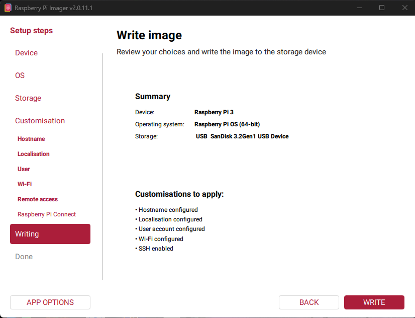

### 2.10 Tampilan setelah terinstall (remote via SSH)
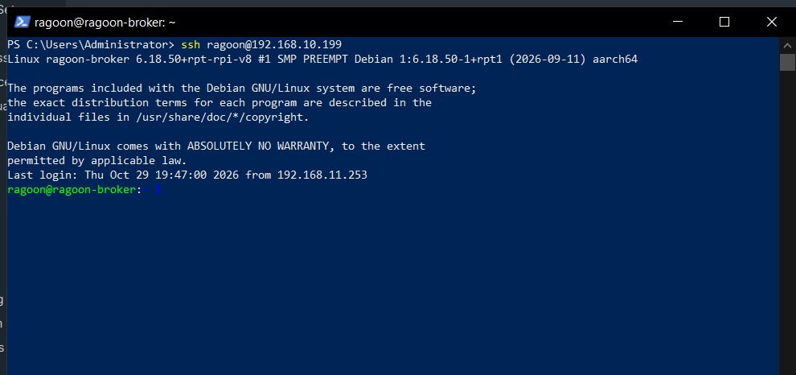
